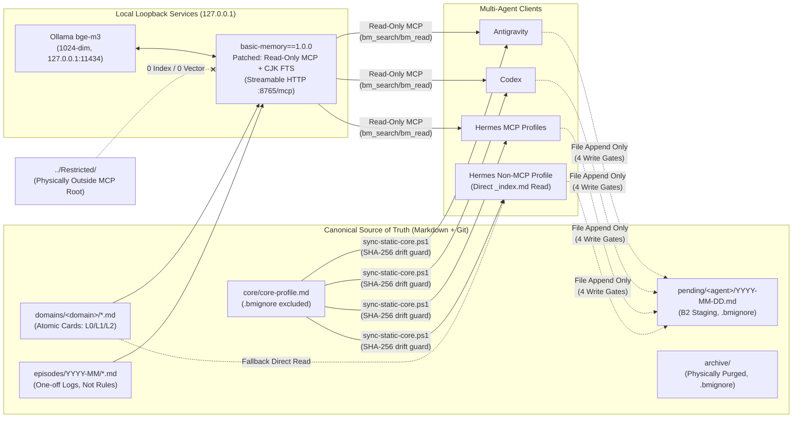

# local-agent-memory

> **English** | [简体中文](./README.zh-CN.md)

**A local-first, Git-canonical, read-only MCP memory architecture for sharing personal context across multiple AI agents (Antigravity, Codex, Hermes, etc.) — with zero cloud lock-in, CJK FTS recall fixes, drift-proof core sync, and red-team isolation gates.**

---

## Why This Exists

Most AI tools now ship their own built-in memory (`MEMORY.md`, hidden SQLite stores, or cloud profiles). As soon as you use more than one agent—say Antigravity for architecture, Codex for coding, and Hermes profiles for daily workflows—you hit four real failure modes:

1. **Split-brain truth**: Every client quietly drifts into its own stale copy of your preferences and project boundaries.
2. **Silent mutation**: Letting an agent freely call `write_note` / `edit_note` corrupts durable rules with one-off session noise.
3. **Broken CJK keyword search**: Out-of-the-box FTS5 tokenization often collapses spaceless Chinese natural-language questions into near-zero recall when vector embeddings are offline or degraded.
4. **Cross-domain privacy leaks**: Vector similarity happily pulls private health/personal notes into unrelated engineering or public writing tasks.

`local-agent-memory` solves these with a strict engineering contract: **Markdown + Git is the single source of truth; SQLite + vectors are disposable derived caches; MCP is strictly read-only; agents stage proposals in `pending/` for human review.**

---

## Architecture Overview



---

## Key Engineering Features

- **Disposable Index, Immutable Truth**: `memory.db` (SQLite FTS5 + `sqlite-vec`) can be deleted and rebuilt at any time from Markdown + Git. `ensure_frontmatter_on_sync=false` guarantees indexing never dirties `git status` (**G2**).
- **Idempotent Patch for `basic-memory==1.0.0`** ([`scripts/apply-zh-fts-patch.py`](scripts/apply-zh-fts-patch.py)):
  1. Reads project-root `<vault>/.bmignore` in addition to global config `.bmignore`.
  2. Adds CJK Bigram + BM25 OR-relaxed fallback with stop-character filtering and a multi-term coverage guard (lifted pure-FTS recall from `1/20` to `20/20` on our 20-query Chinese benchmark while keeping `5/5` negative-sample rejection).
  3. Server-side read-only enforcement via FastMCP `Visibility(False)` hiding `bm_write`/`bm_edit`/`bm_move`/`bm_delete`/`bm_project_delete` and blocking `bm_project(command="create")` by default (`BASIC_MEMORY_READ_ONLY=true`).
- **Two-Tier Graceful Degradation (G9)**: If local Ollama is offline and `bm_search(mode="hybrid")` errors, clients drop to `bm_search(mode="text")` (patched CJK FTS); if MCP itself is unavailable, clients fall back to reading domain `_index.md` directly. When Ollama restarts, `basic-memory` self-heals automatically without a restart.
- **Managed-Block Static Core Sync** ([`scripts/sync-static-core.ps1`](scripts/sync-static-core.ps1)):
  - Dry-run by default (`-Apply` required to write);
  - Supports per-target conditional blocks (`<!-- target: ... -->`) and compact `core-lite` (`<= 2 KB`) extraction;
  - Protects YAML frontmatter lines 1–3 (`trigger: always_on`), creates first-run `.bak` backups, aborts with line diff on SHA-256 drift, enforces UTF-8 (no BOM) + LF, and refuses to touch `USER.md` / `MEMORY.md`.
- **Read-Only Freshness & Governance Auditor** ([`scripts/audit-freshness.py`](scripts/audit-freshness.py)):
  - Zero writes by default; validates frontmatter schema, `permalink` prefixes (`<domain>-*` vs `episode-YYYYMMDD-*`), `L0`/`L1`/`L2` TTL expiry, relative Markdown link integrity, UTF-8/LF hygiene, unauthorized `domains/` uncommitted edits, and `pending/` 14d/30d aging.
  - Explicit `--write-digest` generates `pending/_digest.md` for weekly human review.
- **Production-Tested Windows Keep-Alive** ([`scripts/windows/`](scripts/windows/)):
  - Hidden-window `pythonw.exe` launcher (fixes `sys.stdin=None` crash under GUI-subsystem Python), `HF_HUB_OFFLINE=1` zero silent HuggingFace downloads, `NO_PROXY=127.0.0.1,localhost`, and Task Scheduler 1-minute crash recovery.
- **G0–G9 Acceptance Gate Framework** ([`docs/evaluation-gates.md`](docs/evaluation-gates.md)):
  - Frozen positive/negative/red-team query methodology with explicit failure-to-fallback rules.

---

## 5-Minute Quickstart (Try on the Included Demo Vault)

This repository ships with a **100% fictional** demo vault (`examples/demo-vault/`) so you can test every script immediately without touching personal notes.

### 1. Run the Read-Only Freshness Audit
```bash
python scripts/audit-freshness.py --root examples/demo-vault --strict
```

### 2. Preview Multi-Client Static Core Sync (Dry-Run)
```powershell
powershell -NoProfile -ExecutionPolicy Bypass -File scripts/sync-static-core.ps1 `
  -CorePath examples/demo-vault/core/core-profile.md `
  -ManifestPath scripts/sync-targets.example.json
```

### 3. Deploy Your Own Local Memory Stack
Follow [`docs/client-setup.md`](docs/client-setup.md) to:
1. Pull `ollama pull bge-m3` (1024-dim local embeddings);
2. Install pinned `uv tool install --python 3.14 basic-memory==1.0.0`;
3. Apply `python scripts/apply-zh-fts-patch.py --apply`;
4. Index your own vault and wire Antigravity / Codex / Hermes;
5. Validate with [`docs/evaluation-gates.md`](docs/evaluation-gates.md) (G0–G9).

---

## Repository Layout

```text
local-agent-memory/
├── docs/
│   ├── architecture.md               # 4-layer model, frontmatter, TTL, B2 pending/, isolation
│   ├── evaluation-gates.md           # G0-G9 acceptance matrix & red-team testing
│   └── client-setup.md               # Antigravity, Codex, Hermes & keep-alive setup
├── scripts/
│   ├── apply-zh-fts-patch.py         # Idempotent patcher for basic-memory==1.0.0
│   ├── audit-freshness.py            # Read-only freshness, link, Git & pending/ auditor
│   ├── sync-static-core.ps1          # Managed-block static core synchronizer
│   ├── sync-targets.example.json     # Multi-client target manifest template
│   └── windows/
│       ├── run_mcp_server.py         # Hidden-window pythonw.exe MCP launcher
│       └── register-task-scheduler.ps1
├── templates/                        # Config snippets for basic-memory, Antigravity, Codex, Hermes
└── examples/
    ├── demo-vault/                   # Fictional runnable vault (Alex Chen)
    └── demo-restricted/              # Physical isolation boundary example
```

---

## Measured Baseline (Windows 11 + RTX 5060 Laptop + `bge-m3`)

Results observed during isolated PoC validation on a 15-note vault:
- **G3 Chinese Recall (20 frozen queries)**: Hybrid Top-1 `20/20`, Pure FTS (patched) Top-1 `20/20` (up from `1/20` unpatched); 5 negative queries `5/5` rejected cleanly.
- **G4 Isolation & Red-Team**: `0` hits from excluded/restricted directories; `0/20` private-card misuse across 2 blind rounds.
- **G5 30-Minute Endurance (3 concurrent HTTP clients + `pending/` writes)**: `1,409` MCP ops + `353` file appends, `0` SQLite lock errors, `0` memory/handle/TCP `CLOSE_WAIT`/WAL leaks, normal latency `p50 = 85.2 ms` / `p95 = 156.6 ms`.
- **G6 Offline**: `HF_HUB_OFFLINE=1` -> `0` network downloads, no `fastembed_cache` created.

---

## Platform Notes & Third-Party Licenses

- **Platform support**: Primary verification was performed on **native Windows 11**. All Python scripts (`apply-zh-fts-patch.py`, `audit-freshness.py`) are cross-platform (Windows / macOS / Linux); macOS/Linux users can run `basic-memory` under `launchd` / `systemd --user` and adapt `sync-static-core.ps1` (or run via PowerShell 7 `pwsh`).
- **Licenses**:
  - This repository (`local-agent-memory` docs, templates, demo vault, and original scripts) is licensed under the **MIT License** ([LICENSE](./LICENSE)).
  - `basic-memory` is an independent third-party runtime installed separately by the user and is licensed under **AGPL-3.0-or-later**. This repository does **not** bundle or redistribute any `basic-memory` source code.
  - `Ollama` is licensed under the **MIT License**; `bge-m3` is licensed under the **MIT License**.
