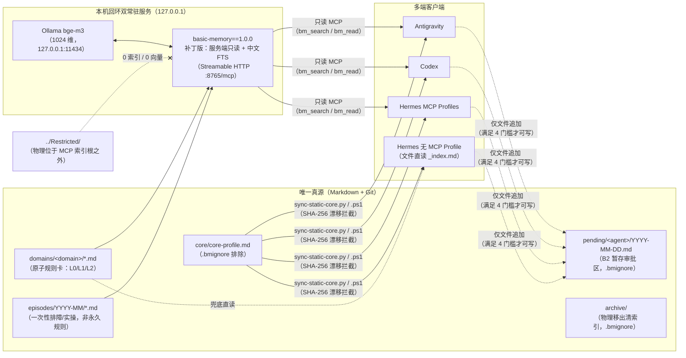

# local-agent-memory

> [English](./README.md) | **简体中文**

**一套本地优先、以 Markdown + Git 为唯一真源、通过本机只读 MCP 跨多端 AI Agent（Antigravity / Codex / Hermes 等）共享的个人全局记忆架构——零云端绑定、内置中文 FTS 召回补丁、防漂移静态核心分发与 G0–G9 红队门禁。**

---

## 为什么做这套架构

现在主流 AI 工具基本都自带记忆（`MEMORY.md`、内置 SQLite 或云端画像）。但只要你同时在用多个 Agent——比如 Antigravity 做架构规划、Codex 写代码、Hermes 多 Profile 跑日常工作流——很快就会撞上 4 个真实痛点：

1. **多端真相分裂**：每个客户端各自演化出一套互不同步的过期偏好和项目边界。
2. **静默污染记忆库**：直接开放 `write_note` / `edit_note` 给 Agent，几次会话后长期规则就会被一次性噪音写脏。
3. **中文自然语言 FTS 几乎失效**：向量离线或降级时，上游默认 FTS5 分词把无空格中文问句拼成整段精确短语，纯关键词召回率往往跌到个位数。
4. **跨域隐私串味**：纯向量相似度会把私密健康/个人日程卡误召回到完全无关的写代码或公开发文任务里。

`local-agent-memory` 用硬契约解决这 4 个问题：**Markdown + Git 永远是唯一真源；SQLite 与向量库只是可删可重建的派生缓存；MCP 服务端默认只读；Agent 只能通过文件工具向 `pending/` 追加 YAML 补丁，经人工审批后才进入正式卡片。**

---

## 总体架构



---

## 核心工程特性

- **派生缓存可删可重建，Git 100% 干净**：`memory.db`（SQLite FTS5 + `sqlite-vec`）随时可删库重建；`ensure_frontmatter_on_sync=false` 保证索引过程绝不回写弄脏 `git status`（**G2**）。
- **面向 `basic-memory==1.0.0` 的幂等三合一补丁**（[`scripts/apply-zh-fts-patch.py`](scripts/apply-zh-fts-patch.py)）：
  1. 补齐读取项目根目录 `<vault>/.bmignore`（原版仅读全局配置目录 `.bmignore`）。
  2. 为中文自然语言查询补齐 Bigram + BM25 OR 松弛层，内置停用字/停用双字词过滤与多词覆盖门槛（在 20 条冻结中文测试集上将纯 FTS Top-1 召回从 `1/20` 提升至 `20/20`，同时保持 `5/5` 负样本零幻觉）。
  3. 通过 FastMCP `Visibility(False)` 在服务端默认彻底隐藏 `bm_write`/`bm_edit`/`bm_move`/`bm_delete`/`bm_project_delete`，并拦截 `bm_project(command="create")`（仅显式设置 `BASIC_MEMORY_READ_ONLY=false` 才放开）。
- **两级无感降级与自动自愈（G9）**：本机 Ollama 离线导致 `bm_search(mode="hybrid")` 报错时，客户端优先降级重试 `bm_search(mode="text")`（依托补丁版中文 FTS）；仅当 MCP 本身不可用或结果为空时再直读域 `_index.md`。Ollama 恢复后 `basic-memory` 无需重启即可自动自愈。
- **托管区块单向分发与防漂移**（[`scripts/sync-static-core.py`](scripts/sync-static-core.py) 与 [`scripts/sync-static-core.ps1`](scripts/sync-static-core.ps1)）：
  - 提供零第三方依赖的跨平台 Python 3 版与 Windows PowerShell 版，二者 **16 位 SHA-256 托管块指纹 100% 互通对齐**；
  - 默认 `dry-run`（加 `--apply` / `-Apply` 才写盘）；
  - 支持按端条件渲染（`<!-- target: ... -->`）与 `<= 2 KB` 的 `core-lite` 精简块提取；
  - 保护 Antigravity 首 3 行 `trigger: always_on`、首次注入自动生成带时间戳 `.bak`、写入前校验 SHA-256 防本地篡改覆盖（漂移即输出逐行 diff 并中止）、强制 UTF-8 无 BOM + LF、硬拦截严禁修改 `USER.md` / `MEMORY.md`。
- **默认纯只读巡检脚本**（[`scripts/audit-freshness.py`](scripts/audit-freshness.py)）：
  - 自动发现 `domains/` 下所有域，校验 Frontmatter 契约、`permalink` 前缀编码（`<domain>-*` vs `episode-YYYYMMDD-*`）、`L0/L1/L2` TTL 超期、相对 Markdown 链接断链、UTF-8/LF 编码、`domains/` 未授权未提交改动及 `pending/` 14 天告警 / 30 天归置。
  - 显式传 `--write-digest` 生成每周人工审批清单 `pending/_digest.md`。
- **Windows 11 无黑框保活套件**（[`scripts/windows/`](scripts/windows/)）：
  - 基于 `pythonw.exe` 启动（自带 `sys.stdin=os.devnull` 补丁修复 GUI 子系统下 `isatty()` 崩溃）、强制 `HF_HUB_OFFLINE=1` 与 `NO_PROXY=127.0.0.1,localhost`，由任务计划程序在当前用户登录时拉起并支持失败 1 分钟自动重启。
- **G0–G9 门禁评测与失败退路矩阵**（[`docs/evaluation-gates.md`](docs/evaluation-gates.md)）：
  - 先在独立副本跑通冻结正/负/红队样本与 30 分钟耐力压测，再切入真实工作流。

---

## 面向 AI Agent 的直接上手指引（让你的 Agent 帮你部署）

如果你是正在读取本仓库的 AI 编程代理（Antigravity、Codex、Claude Code、Hermes、Cursor 等），受用户委托部署 `local-agent-memory`，请严格按以下协议执行，不要跳过检查直接魔改配置：

> **用户一句话唤起模板**：*“阅读 `https://github.com/Dirtytrii/local-agent-memory`（或当前本地克隆仓），先只读盘点我本机的工具链和客户端配置，再按仓库协议分阶段帮我落地这套本地全局记忆系统。”*

### Agent 执行协议
1. **先只读摸底（0 写入）**：依次阅读 [`docs/architecture.md`](docs/architecture.md)、[`docs/client-setup.md`](docs/client-setup.md) 与 [`docs/evaluation-gates.md`](docs/evaluation-gates.md)；只读检查宿主机 OS、Python/`uv`、本机 Ollama（`bge-m3`）及现有客户端配置路径。
2. **动文件前必须向用户确认 4 项输入**：
   - 唯一真源记忆库路径（Git 仓内）与物理隔离的外部 `Restricted/` 路径；
   - 初始领域划分（如 `engineering` / `writing` / `personal`）及哪些域标记为 `sensitivity: private`；
   - 需要接入的客户端列表（区分挂载 MCP 的端与仅文件直读 `_index.md` 的端）；
   - 是否先在临时隔离副本跑通 G0–G4 验收门禁后再接入正式客户端（强烈推荐）。
3. **按安全顺序落地**：
   - 钉死安装 `basic-memory==1.0.0`，运行 `python scripts/apply-zh-fts-patch.py --apply` 并用 `--check` 确认 4/4 `[OK]`；
   - 参照 `examples/demo-vault/` 搭建骨架，运行 `python scripts/audit-freshness.py --root <vault> --strict` 确认 0 错误，且 `bm reindex` 后 `git status` 保持干净；
   - 仅监听回环 `127.0.0.1:8765/mcp` 启动只读服务（强制注入 `HF_HUB_OFFLINE=1`、`BASIC_MEMORY_READ_ONLY=true`、`NO_PROXY=127.0.0.1,localhost`）；
   - 执行 `sync-static-core.py`（或 `sync-static-core.ps1`）时**先跑默认 dry-run 预览**再加 `--apply` / `-Apply`；多端/多 Profile 分批接入，每批通过 G4 隔离验证后再推进下一批。
4. **Agent 硬性红线**：
   - **严禁**修改或覆盖原生 `USER.md`、`MEMORY.md` 与 `.env`；
   - **严禁**默认开放 `bm_write`/`bm_edit`/`bm_move`/`bm_delete` 或让 Agent 直接改写 `domains/`；
   - **严禁**未经确认执行 `git push`、删除 `.bak` 备份，或将 `pending/` 混入常规 Git 提交；
   - **严禁**在未备份的前提下首次修改 `config.toml`、`SOUL.md` 或 `AGENTS.md`。

---

## 5 分钟快速体验（内置虚构 Demo 库）

仓库自带一套 **100% 虚构**的示例记忆库（`examples/demo-vault/`），Clone 下来即可零侵入跑通核心脚本：

### 1. 运行只读新鲜度与治理体检
```bash
python scripts/audit-freshness.py --root examples/demo-vault --strict
```

### 2. 预览多端静态核心分发（默认 Dry-Run，不写入任何文件）
```bash
# 跨平台通用（Linux / macOS / Windows）
python scripts/sync-static-core.py \
  --core-path examples/demo-vault/core/core-profile.md \
  --manifest-path scripts/sync-targets.posix.example.json
```
```powershell
# Windows PowerShell 等价命令
powershell -NoProfile -ExecutionPolicy Bypass -File scripts/sync-static-core.ps1 `
  -CorePath examples/demo-vault/core/core-profile.md `
  -ManifestPath scripts/sync-targets.example.json
```

### 3. 搭建你自己的本地多端记忆层
按 [`docs/client-setup.md`](docs/client-setup.md) 依次执行：
1. 拉取本地向量模型：`ollama pull bge-m3`（1024 维）；
2. 安装钉死版本：`uv tool install --python 3.14 basic-memory==1.0.0`；
3. 施加幂等补丁：`python scripts/apply-zh-fts-patch.py --apply`；
4. 建库索引并接入 Antigravity / Codex / Hermes；
5. 对照 [`docs/evaluation-gates.md`](docs/evaluation-gates.md) 跑通 G0–G9 门禁。

---

## 仓库目录结构

```text
local-agent-memory/
├── .github/workflows/ci.yml          # Ubuntu / macOS / Windows 编码、防泄漏与契约回归 CI
├── docs/
│   ├── architecture.md               # 四层模型、Frontmatter 契约、TTL、B2 pending/、物理隔离
│   ├── evaluation-gates.md           # G0-G9 门禁矩阵、失败退路与红队评测法
│   └── client-setup.md               # Antigravity / Codex / Hermes 接入与保活指南
├── scripts/
│   ├── apply-zh-fts-patch.py         # basic-memory==1.0.0 三合一幂等补丁
│   ├── audit-freshness.py            # 只读巡检与 pending/_digest.md 生成脚本
│   ├── check-repo-hygiene.py         # UTF-8 无 BOM / LF 与路径密钥防泄漏门禁脚本
│   ├── sync-static-core.py           # 跨平台托管区块分发与防漂移同步脚本（Python 标准库）
│   ├── sync-static-core.ps1          # Windows PowerShell 托管区块分发同步脚本
│   ├── sync-targets.example.json     # Windows 多端目标清单示例
│   ├── sync-targets.posix.example.json # macOS / Linux (~/) 多端目标清单示例
│   └── windows/
│       ├── run_mcp_server.py         # pythonw.exe 无黑框启动器
│       └── register-task-scheduler.ps1
├── templates/                        # 多端配置片段 + posix/ systemd 与 launchd 保活模板
├── tests/
│   └── test_repo_contracts.py        # 端到端巡检、双实现哈希一致性与补丁生命周期测试
└── examples/
    ├── demo-vault/                   # 虚构角色（Alex Chen）可运行示例库
    └── demo-restricted/              # 索引根外物理隔离区示例
```

---

## 实测基线（Windows 11 + RTX 5060 Laptop + `bge-m3`）

在 15 篇实测卡片副本上跑完 G0–G9 的实测结果：
- **G3 中文召回（20 条冻结问句）**：Hybrid 混合检索 Top-1 `20/20`，补丁后纯 FTS Top-1 `20/20`（未打补丁前仅 `1/20`）；5 条库外负样本 `5/5` 正确拒答。
- **G4 物理隔离与红队**：隔离/归档/核心/`_index.md` 均 `0` 命中；2 轮 20 次非私密上下文压力测试 `0/20` 误用与泄密。
- **G5 30 分钟并发耐力测（3 端 HTTP 客户端 + 并发写 `pending/`）**：`1,409` 次 MCP 调用 + `353` 次文件追加，`0` SQLite 锁错误、`0` 内存/句柄/TCP `CLOSE_WAIT`/WAL 泄漏，正常延迟 `p50 = 85.2 ms`、`p95 = 156.6 ms`。
- **G6 完全离线**：`HF_HUB_OFFLINE=1` 下 `0` 联网下载，未生成默认 `fastembed_cache`。

---

## 平台说明与第三方许可声明

- **平台支持**：主生产验证环境为 **Windows 11 原生**，并由 GitHub Actions 在 **Ubuntu / macOS / Windows** 三平台持续验证编码、巡检与同步契约。全部核心运维脚本（`sync-static-core.py`、`apply-zh-fts-patch.py`、`audit-freshness.py`、`check-repo-hygiene.py`）均仅依赖 Python 3 标准库实现跨平台开箱即用，并在 [`templates/posix/`](templates/posix/) 附带 `systemd --user` 与 `launchd` 保活单元模板。
- **许可证说明**：
  - 本仓库内的原创文档、模板、示例库与脚本采用 **MIT License**（见 [LICENSE](./LICENSE)）。
  - `basic-memory` 为用户自行安装的独立第三方运行依赖，其上游许可证为 **AGPL-3.0-or-later**；本仓库**不打包也不再分发**任何 `basic-memory` 源码。
  - `Ollama` 与 `bge-m3` 均采用 **MIT License**。
